<div align="center">

# dailyDSA

**One problem a day. One pattern a week.**

DSA practice for a small, invite-only group, with original problems, a hidden pattern tag and a real sandboxed judge.

🚧 **Live site: coming soon** 🚧

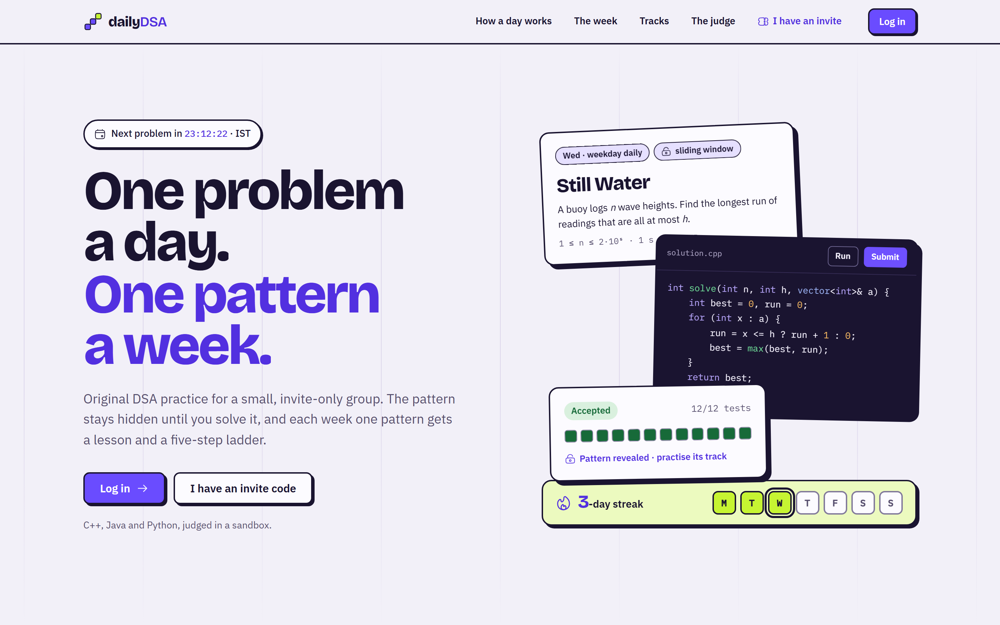

</div>

---

## What it is

dailyDSA has two parts:

- **The daily problem.** Everyone gets the same new problem at midnight IST. Its pattern is **hidden** until you solve it (or open the solutions), so you practise working out *which* technique a problem needs, not just applying one you were told.
- **The weekly track.** Each week covers one pattern: a lesson on Monday, then a ladder of five problems that opens one a day and gets harder as it goes. At the weekend there's a harder problem of the same pattern, and its tag stays hidden.

All problems are original, and none are copied from other platforms. Solutions are judged in **C++17, Java 21 and Python 3**.

## Screenshots

### Today

The daily problem with a countdown to midnight IST, how many of the group have solved it today, your streak, the last 30 days and the week laid out as Daily and Ladder rows.

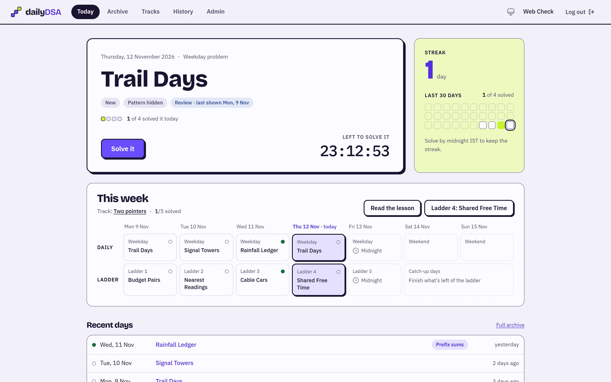

<details>
<summary>On a phone</summary>

Today, the problem statements and the tracks work on a phone, for checking your streak or reading the problem on the way. The editor stays on the laptop.

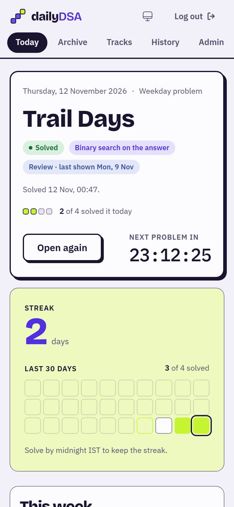

</details>

### The problem page

Statement on the left, Monaco editor on the right, results underneath. **Run** checks the samples plus your own input; **Submit** runs every hidden test.

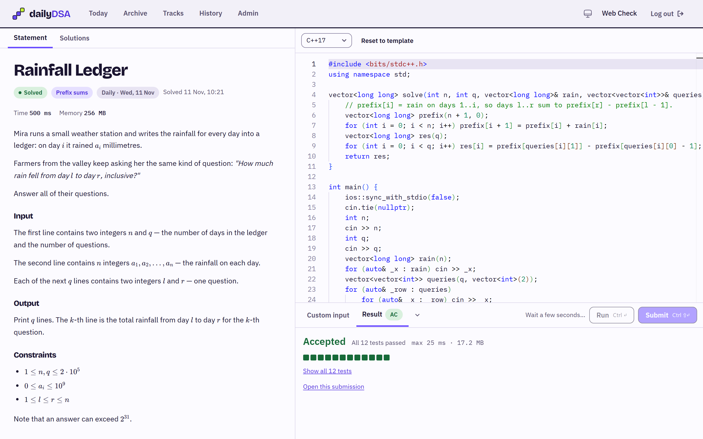

Solving a daily for the first time reveals its pattern: the hidden card turns over to show the pattern and a small diagram of it, and today's square fills in.

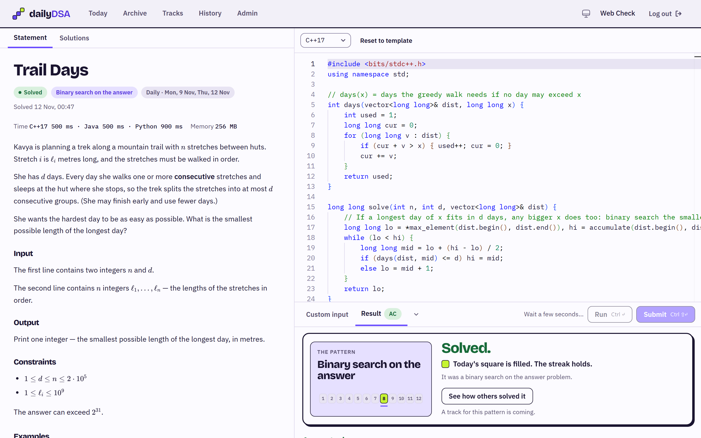

<details>
<summary>Dark mode (follows your OS)</summary>

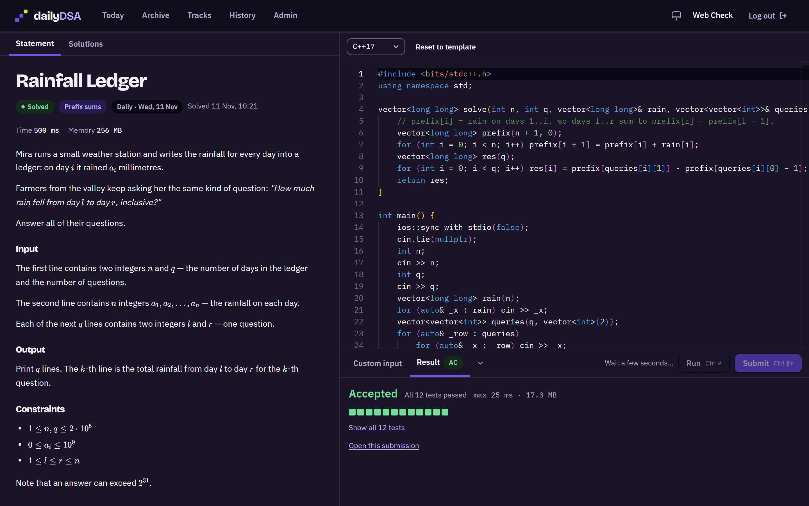

</details>

### Tracks and lessons

One pattern a week, laid out as a timeline with this week's track first. Each pattern has a small diagram of it at work, and each track has a lesson (a step-through of that diagram, "how to spot it", the core idea, worked examples in all three languages, common mistakes) and a five-problem ladder with three hints per problem.

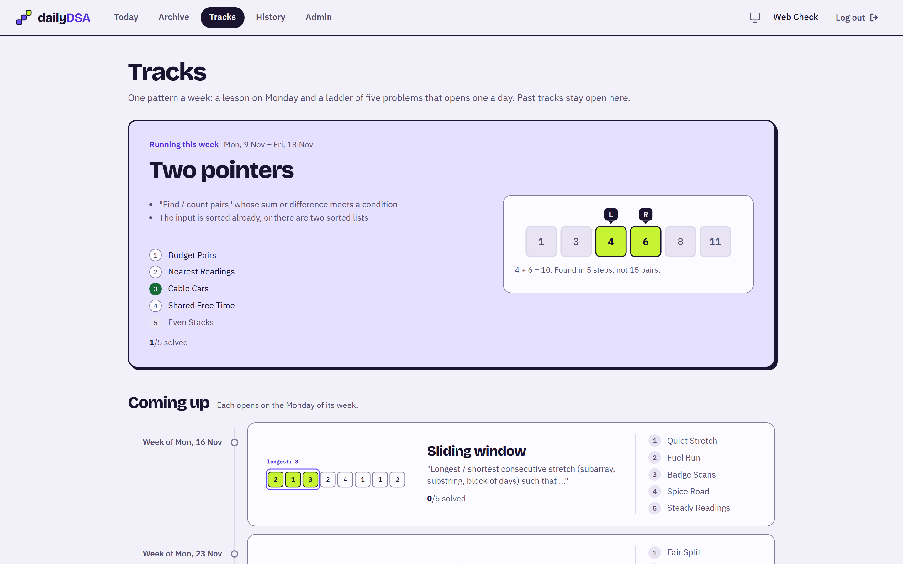

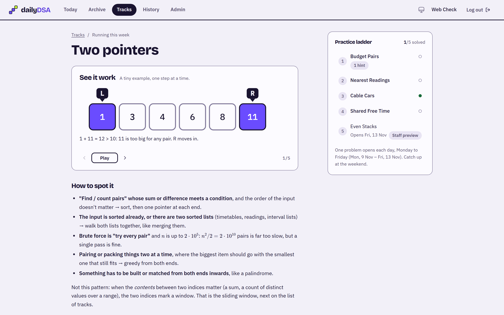

### The judge

Code runs in a sandbox against hidden tests. Time limits come from the reference solutions in each language, so Python isn't punished for being Python. When a hidden test fails, you see its input.

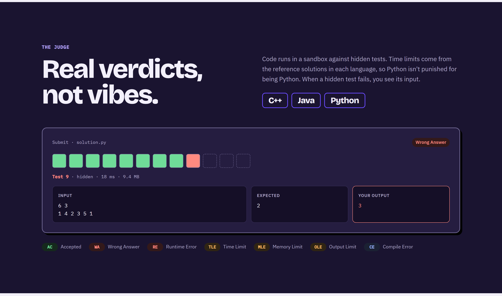

### History

Your own record, visible only to you: what you solved, in which language, how many submits it took, and whether you'd looked at the solutions first.

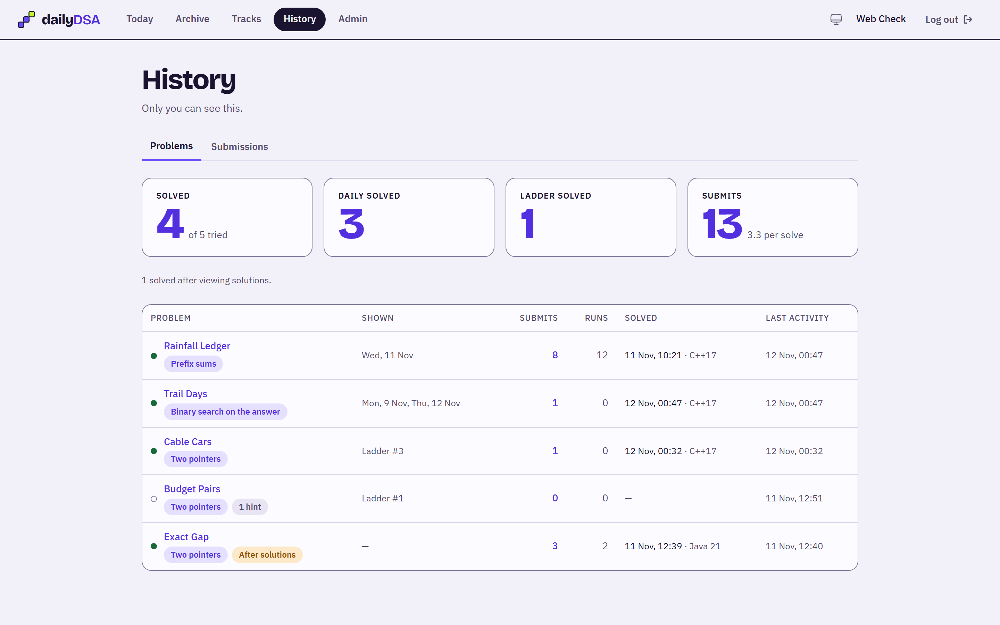

### Admin

Pin a problem to a future day, choose which track runs each week, and manage problems, lessons, users and invite codes.

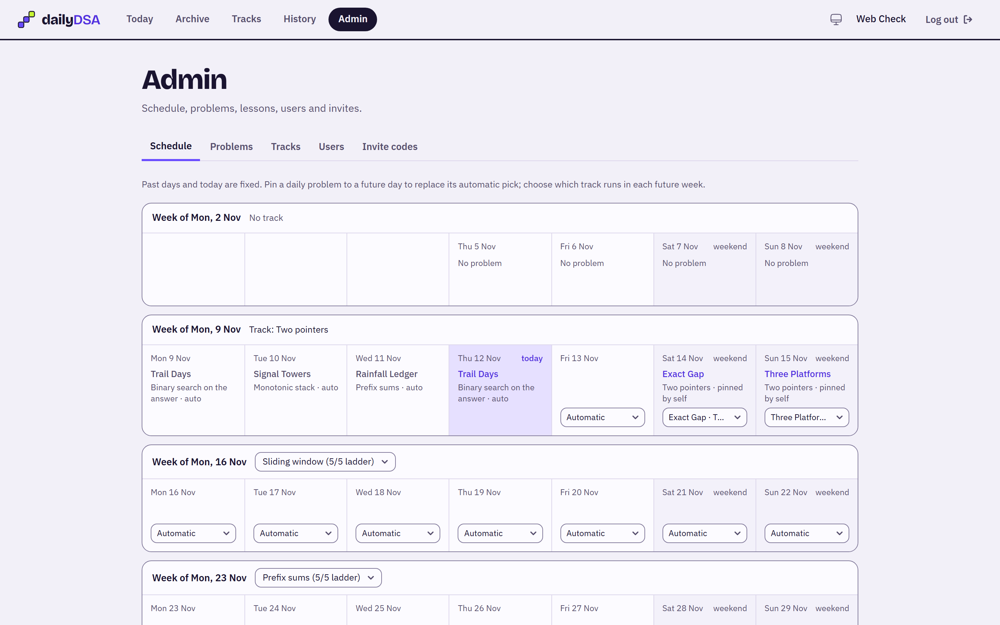

<details>
<summary>Log in</summary>

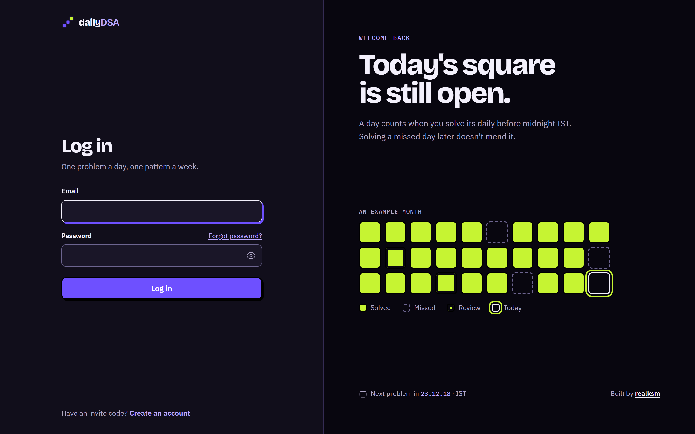

</details>

## Features

**Daily problem**
- New problem at midnight IST, picked from separate **weekday** (easier) and **weekend** (harder, from the week's pattern) pools
- Pattern tag hidden until you solve the problem or unlock its solutions, then linked to the matching track
- Every past day stays open in the **archive**; a repeated problem shows as review with your earlier result
- Streaks count only days solved before midnight IST, with an optional reminder email at 9 pm IST when a streak is about to break
- The pattern is revealed on your first accepted submission, with a diagram of it

**Tracks**
- A lesson per pattern with KaTeX maths, code examples in all three languages and a step-through diagram
- A five-problem ladder that opens one rung a day (Mon–Fri), with 3 hints per problem
- Tracks so far: **two pointers, sliding window, prefix sums, binary search on the answer** (20 ladder problems + 8 weekend problems + 3 weekday dailies)

**Judge**
- [go-judge](https://github.com/criyle/go-judge) sandbox: no network, CPU time and memory limits
- Verdicts: AC, WA, RE, TLE, MLE, OLE, CE
- Custom checkers for problems that accept more than one correct answer
- Limits calibrated from each language's reference solution

**Accounts and admin**
- Invite-only signup, password reset by email, rate-limited logins
- Roles: solver, setter, admin
- Admin pages for the schedule, problems, track lessons, users and invite codes
- Light and dark themes (system by default, switchable in the top bar); Today, statements and tracks work on phones

## Tech stack

| Layer | Stack |
|---|---|
| Web | React 19, Vite, Monaco editor, react-markdown + KaTeX, GSAP + Lenis (landing page only) |
| API | Node.js, Express, TypeScript, zod, argon2 password hashing, cookie sessions |
| Database | PostgreSQL 17 (the `submissions` table doubles as the judge queue) |
| Judge | go-judge in Docker with g++, OpenJDK 21 and Python 3 |
| Tooling | pnpm workspaces, Vitest, a `dsa` CLI for writing, validating and importing problems |

## Repo layout

```
apps/web          React app: today, archive, tracks, lessons, problem editor, history, admin, landing page
apps/server       Express API + the judge worker
packages/shared   types shared by front and back end
packages/judge    go-judge client and the compile → run → check pipeline
packages/db       Postgres pool and SQL migrations
packages/cli      `pnpm dsa`: new / validate / import problems and tracks, admin and invite commands
judge/            the go-judge Docker image
problems/         one folder per problem (statement, generator, reference solutions in 3 languages)
problems/_tracks/ ladder order and lesson for each track
```

## Running it locally

You need **Node.js 24+**, **pnpm** and **Docker**.

```sh
docker compose up -d --build          # judge on :5050, Postgres on :15432
pnpm install
pnpm db:migrate

pnpm dsa validate --all               # generate tests and check every problem in the sandbox
pnpm dsa import --all                 # load problems + tracks into the database

pnpm dsa admin create you@example.com "Your Name"   # prints a generated password
pnpm server                           # API on http://127.0.0.1:3000
pnpm web                              # app on http://127.0.0.1:5173
```

Without `SMTP_URL`, emails such as password-reset links are printed to the server console. Run `pnpm test` for the test suite and `pnpm typecheck` to typecheck everything.

## Writing problems

Every problem lives in git as a folder under `problems/`: a `problem.yaml`, a Markdown statement, a Python test generator, reference solutions in C++, Java and Python, a slow "naive" solution that must time out, and an optional checker. `pnpm dsa validate` runs all of it in the sandbox and calibrates the time limits; `pnpm dsa import` refuses anything that hasn't been validated. See [`problems/README.md`](problems/README.md) for the full format.

## Status

The platform and the first four tracks are built. Hosting is next, so the **live site is coming soon**. If you'd like an invite when it opens, reach out on GitHub.

---

<div align="center">

Made by [realksm](https://github.com/realksm)

</div>
